# florilegium, with cats

Pages that grow their own pictures. This is Ilse Funkhouser's fork of Kevin Raymond's
[florilegium](https://github.com/kevinraymond/florilegium), the LuaLaTeX package that grows
Delft-blue flowers in the margin of a page. The fork adds cats: a cat gym that builds itself
around the text, one huge oak that turns with the seasons, and Felilegium, a web app that turns a
post into pages with a cat gym, an oak or Kevin's flowers growing around the words. None of it is
an image file or a stock drawing. Every post, petal, leaf and whisker is a curve computed while
the page is made, so every seed grows a different page.

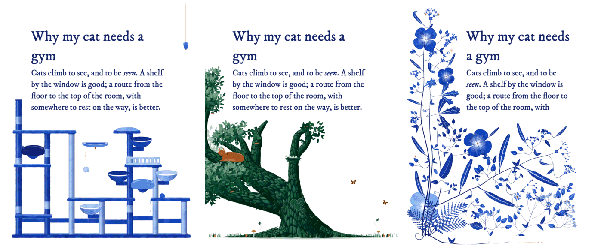

*One post, three ways: the same words with a cat gym, an oak and Kevin's flowers, each exported
from Felilegium as a 1080 px Instagram page.*

**[Make a post in Felilegium](https://felilegium.corporateshill.com)** ·
[the cat gym](#the-cat-gym) · [the oak](#one-huge-oak) · [Kevin's flowers](#kevins-flowers) ·
[Kevin's original repository](https://github.com/kevinraymond/florilegium)

## Felilegium

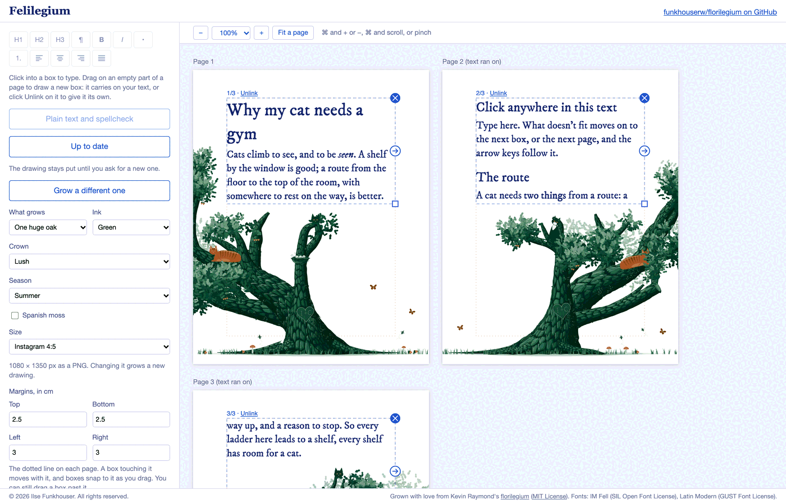

Felilegium is for posts, carousels and printed pages. Draw a box on a page, type in it, and pick
what grows around your words:

- **A cat gym**, **one huge oak** (lush or open crown, any season, Spanish moss if you like),
  **Kevin's flowers** (spring, summer or autumn), or the first, chunkier cats.
- Text flows from box to box and onto new pages as you type. A new box carries on the text
  you're in; "Unlink" on its label gives it text of its own.
- Headings, bold, italic, lists and alignment, with Markdown shortcuts as you type
  (`# `, `- `, `**bold**`, `*italic*`). Accents and emoji work too.
- Each box keeps the drawing clear of it, or sets its text over or behind the drawing.
- Instagram 4:5, square, story 9:16, A4 and US Letter pages; margins on all four sides; the
  pages zoom without the panel changing size.
- Export PNGs (1080 px wide for social media), a PDF with real text you can select, or one
  self-contained HTML file. Your work is kept in the browser and can be saved as a file.

The drawing only changes when you ask: "Generate" catches it up with your changes, and "Grow a
different one" tries a new seed. It grows in your browser: the same Lua that draws the LaTeX
pages, run in [wasmoon](https://github.com/ceifa/wasmoon) (Lua compiled to WebAssembly), so
there is no server. Growing needs the network, since wasmoon loads from jsDelivr. Felilegium is
tested in Chrome.

To run it yourself:

```sh
cd apps/studio
npm install
npm run dev          # http://localhost:5173/
npm run build        # a static site in apps/studio/dist (about 3.3 MB)
```

The built site has to sit at the root of a domain, as it does at felilegium.corporateshill.com,
because its fonts load from `/fonts/`.

## The cat gym

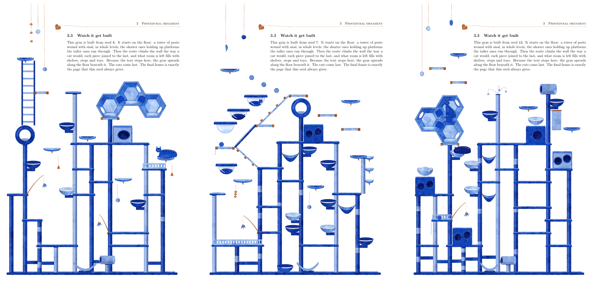

*Three seeds of the cat gym in a LuaLaTeX margin (4, 7 and 12), each the last frame of its
animation.*

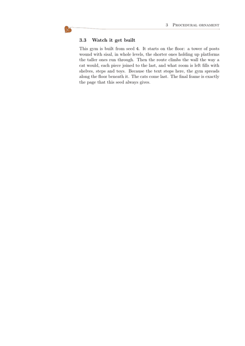

`theme=cattree` turns the margin into a cat gym, drawn at one twentieth of real size (a hexagon
is 60 cm across, a post 9 cm thick), so a cat fits every hexagon and basket. It is heavy at the
floor and lighter as it rises:

- **The tower**: posts in whole levels, the shorter ones holding up platforms the taller ones
  run through, with crossbeams, hammocks, condos, baskets on arms, rings and sisal tubes.
- **The wall**: a route of boards, a rope bridge never steeper than 15 degrees, hexagons and a
  clear bubble.
- **The top**: a few half-moon shelves joined by floating steps, pegs and dots.

Every new piece joins the gym by a way a cat could climb: floating steps when it's level, a sisal
ramp or gangway stairs on a slant, a ladder or a pole with half-round steps going up, or nothing
at all where a cat would just jump. On a last page with room under the text, the gym turns along
the floor into an L, often a U with a bridge back to the tower. `density` thins it down to the
tower alone.

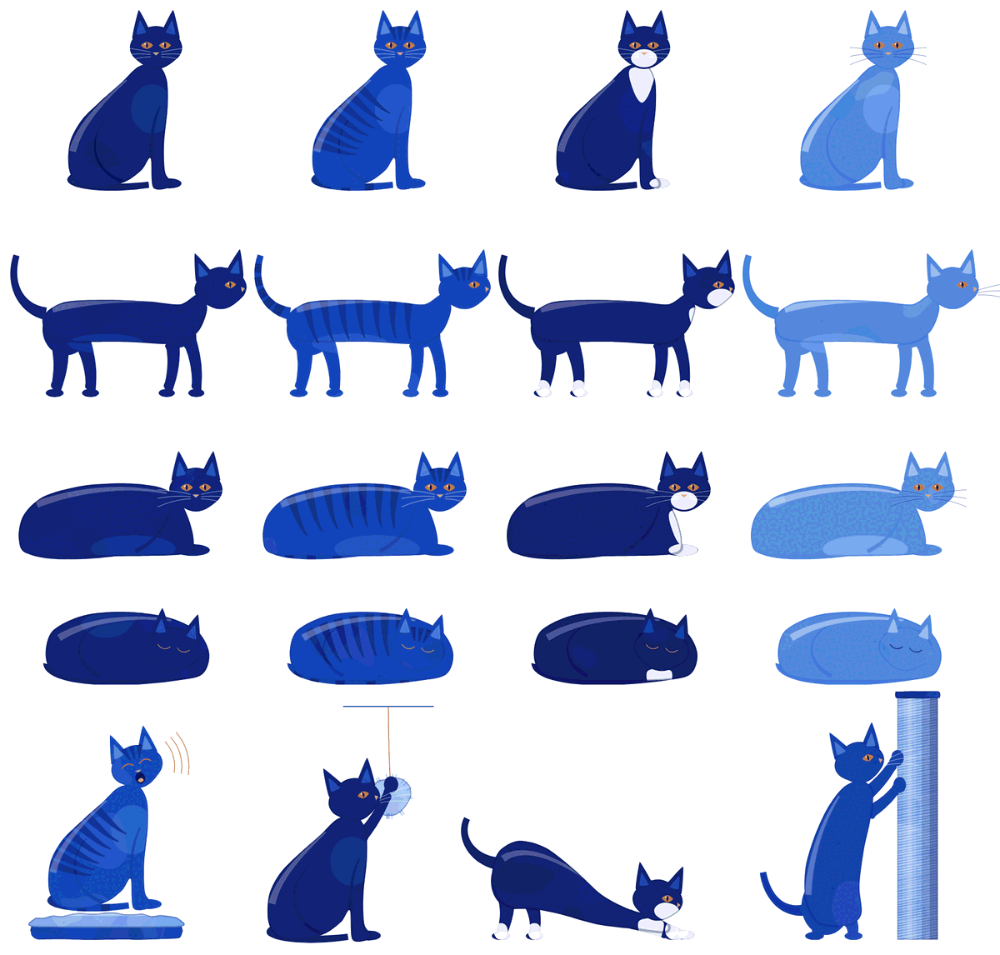

*The cats: solid, tabby, tuxedo and pale coats, sitting, walking, loafing and curled asleep, and a
few things cats do: meowing at a heading, batting a toy, stretching, scratching a post.*

One or two cats settle wherever they fit: on a shelf, draped over an edge, peeking out of a
condo, walking across the bridge. `\florilegiuminitial` puts a cat on the first letter, or curls
one up inside it. `cattree.tex` is a document in the theme, and
`python3 tools/animate.py --seed 4 --theme cattree` films a gym building itself (it needs
LuaLaTeX, `pdftoppm` and `ffmpeg`).

## One huge oak

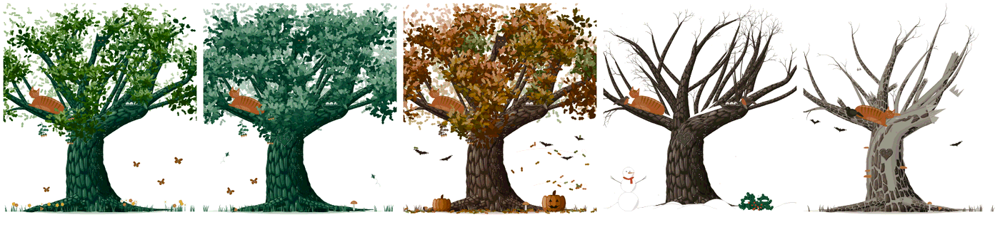

*One oak (seed 3) through the year, as Felilegium grows it: spring and summer, pumpkins and
falling leaves in autumn, a snowman in winter, and bats around it once it has died. The cat stays
put.*

`theme=oak` grows one huge oak on every page, around the text block, the head rule and the page
number. Its limbs reach into whatever room the text leaves, and long near-level limbs sweep out
where there is space beside the trunk. Cats lie along the branches; there are nests, acorns,
butterflies, mushrooms in the grass, a heart carved in the trunk, and a swing on a last page.
Roots run along the ground from behind the trunk.

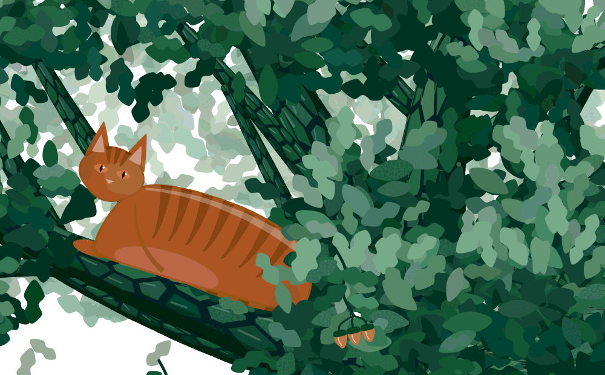

*Close up: the bark, the leaves and the acorns are drawn too, so the oak holds up when you zoom in.*

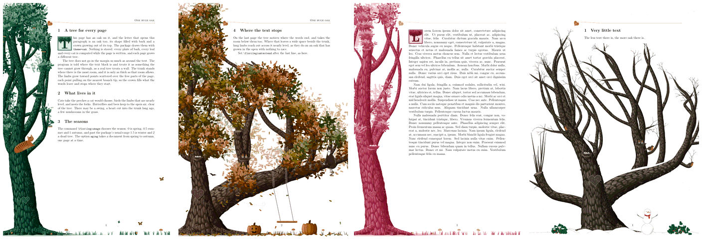

*In LuaLaTeX: the first letter becomes a tree; the last page's oak spreads where the text stops,
with a swing; the oak in the document's own ink; and a short page in winter.*

`\florilegiumage` sets the season: 0 is spring, 0.5 summer, 1 autumn, 1.5 winter and 2 a dead
tree. The oak comes in its own greens and browns, takes the document's ink if you set one, and
`theme=oakblue` draws it in the ink even at the default Delft blue. `oak.tex` describes it all,
on pages grown by the theme.

## Kevin's flowers

| six seeds | watch it grow |
|---|---|
| 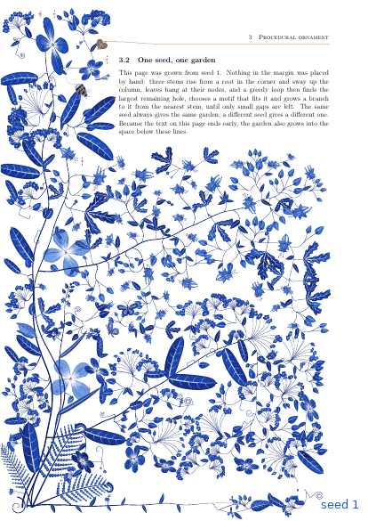 | 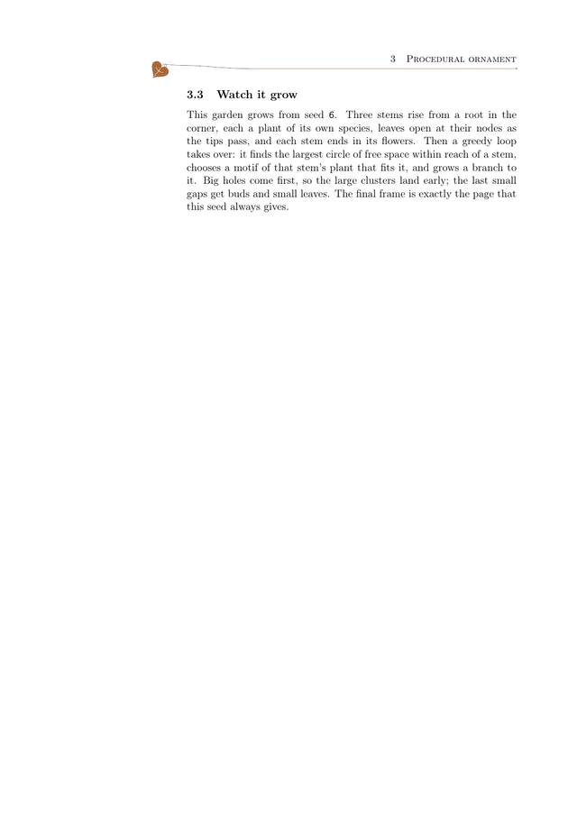 |

*Kevin's grown margin. Same code, different seed, and the garden fills whatever space the text
leaves free; on the right, seed 6 grows from an empty margin to its finished page.*

Under the cats is Kevin Raymond's florilegium 2.0, and it's still all here. Each plant in a grown
margin is a species: 62 traits sampled from one of fifteen body plans that keep botany's rules,
so a lily has its parts in threes and a pea flower is two-sided with a pod. A document gets
eight species and each page grows four. Visitors come with them, from their own genomes:
butterflies, bees, dragonflies, ladybirds, caterpillars, snails and birds, each plant bringing
the one its flowers are for.

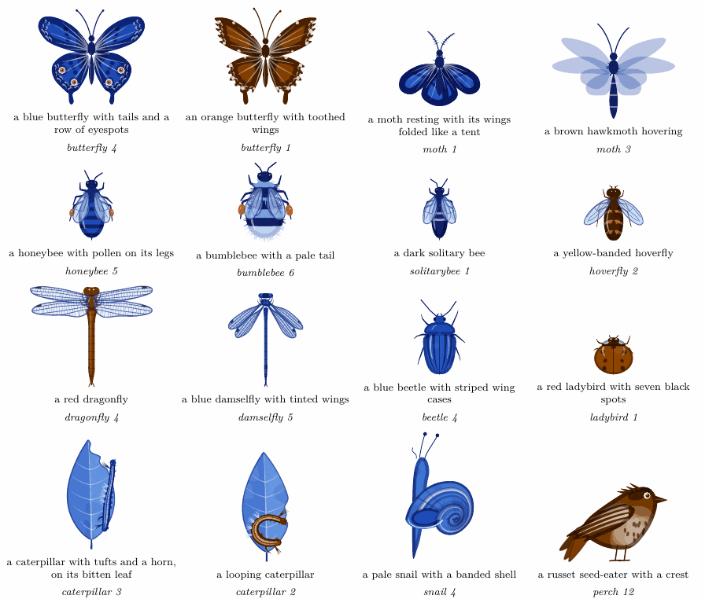

In Felilegium, choose "Kevin's flowers": the garden treats your text boxes as the text block,
grows on the wider side of the page and fills the space under where the text ends, as it does on
the last page of a document. Each seed is a new set of plants.

Kevin's [README](https://github.com/kevinraymond/florilegium#readme) tells the rest, with
pictures: how the growth loop works, the margin that reads the text (flowers at headings,
seasons through a document), the TikZ library that draws the same plants in pure TikZ, the
geometric and math themes, the playground, the PostScript port, and the ports others have made.

## Quick start

With LuaLaTeX, put `florilegium.sty` and the `florilegium*.lua` files from this repository beside
your document (or upload them to an [Overleaf](https://www.overleaf.com) project set to LuaLaTeX).
[Kevin's releases](https://github.com/kevinraymond/florilegium/releases/latest) have the flowers,
the TikZ library and the manual, but not the cats or the oak.

```latex
\usepackage[a4paper,left=68mm,right=22mm]{geometry}   % a wide margin for the garden
\usepackage[grown,sections]{florilegium}              % Kevin's flowers, at the headings too
% \usepackage[grown,theme=cattree]{florilegium}       % or a cat gym
% \usepackage[grown,theme=oak]{florilegium}           % or one huge oak (theme=oakblue: in the ink)
\definecolor{ink}{HTML}{5B2A1F}                       % optional: any hue (this is sepia)
...
\florilegiumage{1}                                    % optional: autumn
\florilegiuminitial[4]{T}his paragraph starts with a decorated T.
\florilegiumtextend                                   % at the very end: fill the space below
```

With pdfLaTeX, or in any TikZ picture, the TikZ library draws Kevin's species in pure TikZ
(it needs only its two `tikzlibraryflorilegium*.code.tex` files):

```latex
\usepackage{tikz}
\usetikzlibrary{florilegium}
\begin{tikzpicture}
  \pic {florilegium plants={plants={3/rose, 17/umbellifer, 29/mustard}, size=21cm, width=6cm}};
\end{tikzpicture}
```

[Using the package](docs/usage.md) lists every option and command.

## Origin

Kevin Raymond made florilegium to answer a
[Reddit post](https://www.reddit.com/r/LaTeX/comments/1xixznw/how_do_you_make_these_flowers_in_latex/)
asking how to make flowers like these in LaTeX. Its first way, in 1.3, paints hand-designed
flowers with randomized parameters in Lua and places them with a procedural layout whose "fill
the unused space" part borrows a 1998 idea from the ornament literature. In 2.0 the plants and
animals are sampled from genomes of botanical traits, so what grows is procedural too, not only
where it grows. It gets a similar look to the original without replicating it. Kevin made it with
the assistance of AI (Claude) and shares [the process he used](PROCESS.md).

Ilse Funkhouser forked it to grow cats. The cat gym came first, as a theme for the margin, then
the oak, then Felilegium, so the same drawings could go on a blog post or a carousel. The fork
was also written with Claude (Claude Code). The pictures are procedural code throughout, with no
generative image models.

## Documentation

- [Using the package](docs/usage.md): options and commands, seeds, colors, initials, headings,
  seasons, density, two-sided pages and ornaments.
- [The species garden](docs/species.md): Kevin's genomes, body plans and visitors.
- [The TikZ library](docs/tikz.md) and [the traits](docs/traits.md): the pics, their keys and
  every trait a pic can fix.
- [Themes](docs/themes.md): geometric and math, and how to write a theme. The cat gym and the
  oak are described above.
- [How it works](docs/how-it-works.md): the painting, the growth loop, the initials and the
  animation.
- [SVG, Typst and the browser](docs/svg-and-web.md) and [the PostScript port](postscript/README.md):
  the garden without TeX.
- [Building and checking](docs/building.md): every `make` target and check.
- [CLAUDE.md](CLAUDE.md): a map of the code, its conventions and traps.

## Build

```sh
make                        # Kevin's four PDFs and the manual (LuaLaTeX)
make cattree.pdf oak.pdf    # the cat gym and oak documents
make RUN=tools/in-docker    # the same in a TeX Live image, after: docker build -t florilegium-tex tools
make playground             # Kevin's browser playground at http://localhost:8000/web/
cd apps/studio && npm install && npm run dev   # Felilegium
```

## Credits

- [florilegium](https://github.com/kevinraymond/florilegium) is Kevin Raymond's, and so is
  everything in this repository that isn't about cats, oaks or Felilegium.
- The [Reddit post](https://www.reddit.com/r/LaTeX/comments/1xixznw/how_do_you_make_these_flowers_in_latex/)
  that asked the question (see [Origin](#origin)).
- The growth loop follows Wong, Zongker & Salesin,
  [*Computer-Generated Floral Ornament*](https://dl.acm.org/doi/10.1145/280814.280948) (SIGGRAPH 1998).
- The tone ramp is computed in [Oklab](https://bottosson.github.io/posts/oklab/), Björn Ottosson's
  perceptual color space; the conversion matrices in `florilegium-ink.lua` are his, released into
  the public domain (or under the MIT license, for those who prefer it).
- The random numbers come from [mulberry32](https://gist.github.com/tommyettinger/46a874533244883189143505d203312c),
  Tommy Ettinger's generator, dedicated to the public domain (CC0). The PostScript port uses the "minimal standard"
  generator of Park and Miller (Communications of the ACM, 1988) by Schrage's method (ACM
  Transactions on Mathematical Software, 1979).
- The species' trait tables follow research notes made for this project. Only a radially
  symmetric flower varies its number of petals, as Damerval and Nadot found in the buttercup
  order (Annals of Botany, 2007). Flowers and visitors are paired by the pollination syndromes
  of the U.S. Forest Service's
  [*Pollinator Syndromes*](https://www.fs.usda.gov/wildflowers/pollinators/What_is_Pollination/syndromes.shtml)
  page. Heads and daisy discs are packed on Helmut Vogel's model of the sunflower (Mathematical
  Biosciences, 1979), and a butterfly's pattern follows the nymphalid groundplan of Schwanwitsch
  (1924) and Süffert (1927). A snail's shell is Raup's coiled tube (Journal of Paleontology,
  1966), its ring placed as Okabe and Yoshimura reparameterize it (Scientific Reports, 2017).
- The TikZ library draws with [PGF/TikZ](https://github.com/pgf-tikz/pgf) (Till Tantau and
  others; LPPL 1.3c or GPL 2), and its random numbers and arithmetic are pgfmath's, by Mark
  Wibrow, whose ln follows an algorithm due to Rouben Rostamian with coefficients by Alain
  Matthes. `florilegium-pgfmath.lua` reimplements the part the species need in Lua (pgf's
  generator; pgfmath's reading and printing of numbers, its multiply, divide, ln, exp and
  pow). It is not part of pgf; its header says how it differs and where pgf is, as the LPPL
  asks of a derived work, and like pgf it is under the LPPL 1.3c.
- `--bleed` in `florilegium-svg.lua` comes from jfoboss's e-book port, whose unclip step it
  does. jfoboss proposed it for Kevin's repository in
  [#27](https://github.com/kevinraymond/florilegium/pull/27), whose test page and part-title
  example are in 2.0.
- The repository's social image writes "florilegium" along the strokes of the Hershey Script
  Simplex font, which Dr. A. V. Hershey made at the U.S. National Bureau of Standards; its data
  format is James Hurt's (Cognition, Inc.). `tools/hershey/README.md` gives the font data's
  source and terms.
- `\florilegiumornament`, its `ink` and `seed=random` keys, and the `density` option answer
  [issue #4](https://github.com/kevinraymond/florilegium/issues/4) from rubyFeedback.
- The playground and Felilegium run the Lua in the browser with [wasmoon](https://github.com/ceifa/wasmoon)
  (MIT); the playground typesets the math theme's equations with [MathJax](https://www.mathjax.org) (Apache 2.0),
  both loaded from jsDelivr. The playground and Felilegium are set in Igino Marini's IM FELL DW Pica (SIL OFL) and Latin Modern
  (GUST e-foundry, GUST Font License); see `web/fonts/README.md`. The playground's color-blindness views use
  the model of Machado, Oliveira & Fernandes, *A Physiologically-based Model for Simulation of
  Color Vision Deficiency* (IEEE TVCG, 2009).
- Felilegium lays out its text with Cheng Lou's [Pretext](https://github.com/chenglou/pretext),
  edits it with Marijn Haverbeke's [ProseMirror](https://prosemirror.net), writes PDFs with
  Andrew Dillon's [pdf-lib](https://pdf-lib.js.org) and fontkit, and is built with
  [React](https://react.dev) and [Vite](https://vite.dev), all under the MIT license.
- The math theme's figures keep the names of the people they come from: Maurer's roses, Vogel's
  model of the sunflower, Temple Fay's butterfly curve, the Petersen graph, Koch's snowflake,
  Hilbert's curve, Lissajous figures, the gasket of Apollonius.

## License

MIT, see [LICENSE](LICENSE), except `florilegium-pgfmath.lua`, which reimplements part of pgf in
Lua and is distributed under the [LaTeX Project Public License 1.3c](https://www.latex-project.org/lppl/lppl-1-3c/),
as its header says. Copyright (c) 2026 Kevin Raymond. The cat gym, the oak, the old cats and the scene files
(`florilegium-theme-cattree.lua`, `florilegium-theme-oak.lua`, `florilegium-theme-oakblue.lua`,
`florilegium-theme-oldcats.lua`, `florilegium-scene.lua`) are Copyright (c) 2026 Ilse Funkhouser,
under the same MIT license, as their headers say.
