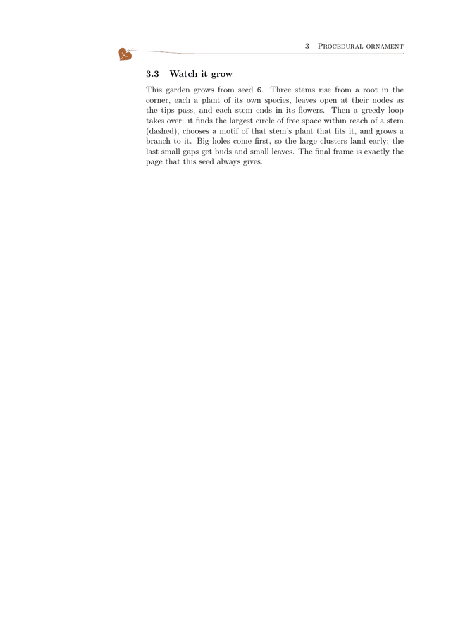
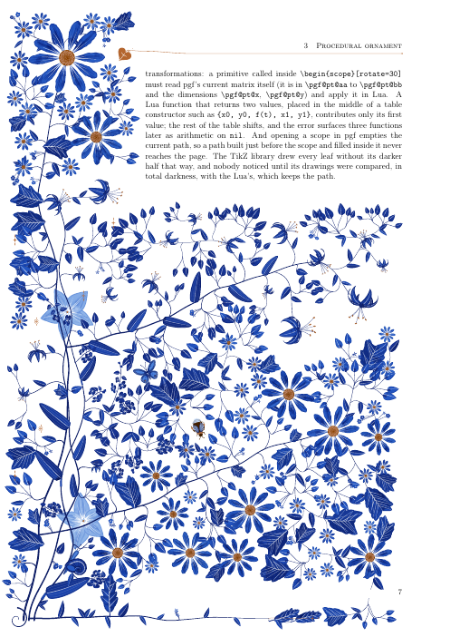

# How it works

All geometry is computed in Lua while LuaLaTeX ships the page out, and written into the page
as PDF path operators. TeX does no arithmetic, and nothing is an image: every petal, leaf and
stem is a curve computed from the page's seed. The files are listed in
[CLAUDE.md](../CLAUDE.md), which maps the code in more detail.

## Painting

`florilegium-ink.lua` is the drawing core. Primitives are drawn in a local frame under an
affine transform, which is read from TikZ when a primitive is called inside a scope. Colors
come from a tone ramp derived from the one document color `ink`, from navy to mist at the hue
of `ink`, interpolated in OKLCH so the light end stays blue instead of turning gray. Tapered
strokes are two offset Béziers, not sampled ribbons. Washes are translucent and multiplied,
like pigment laid over pigment.

Everything is painted in the order a watercolorist would use: a flat wash, darker blotches
multiplied over it, pigment pooling at the edges, streaks lifted out in white, a few fine
veins, and almost no outlines. v1.3's primitives (`florilegium-flora.lua`) are broad petals and
flowers, star lilies seen at a tilt, blossoms and florets, buds and bellflowers; lobed and
entire leaves; forget-me-not cymes that curl like a scorpion's tail, branching sprigs, umbels,
tendrils, seed heads; butterflies, bees, snails and a bird; copper sparkles, rosettes and the
ivy-leaf fleuron whose stem becomes the head rule. Any of them can be painted as a pale ghost.
The species' organs (`florilegium-native.lua`) are painted the same way (see [the species
garden](species.md)).

*300 dpi. Mottled washes with white streaks lifted out, leaves with white veins, a songbird on
its twig, and a pale ghost lily behind the stems.*

## The grown margin

The grown composition (`florilegium-grow.lua`) follows Wong, Zongker and Salesin,
[*Computer-Generated Floral Ornament*](https://dl.acm.org/doi/10.1145/280814.280948) (SIGGRAPH
1998).

*Seed 6 growing. Each dashed circle is the largest free disc the loop found, just before a
branch grows to it.*

1. **Regions.** The garden may grow in the margin column, in a band along the bottom of the
   page, and on the last page in the space below the text.
2. **Stems.** Three stems rise from a root near the bottom corner, each swaying as smooth noise
   of its height, so they cross now and then. Each is one plant, a species of its own. The
   tallest ends in the hero's largest flower at the top of the page, the others stop at about
   two thirds and two fifths of it. A fourth stem runs along the bottom of the page as the
   footer.
3. **Leaves** hang at the nodes, as the species sets them (alternate, opposite, whorled), only
   where there is room.
4. **Free space.** A grid of points 2 mm apart keeps, for each point, the radius of the largest
   free disc around it and its distance to the nearest stem. Every motif placed is a disc too,
   counted at 85% of its radius so that a leaf can tuck under the edge of a flower.
5. **The loop.** Take the largest free disc within 3 cm of a stem (with a random factor, so ties
   break differently on every seed), choose a motif of the plant whose stem is nearest that
   fits it, scale it to the hole, and grow a branch to it from that stem. The branch leaves its
   stem along the stem's own direction and arrives along the motif's axis, so every flower can
   be traced back to the root, and it becomes a stem for later branches. Stop when no hole
   larger than 3.6 mm is left.
6. **Filling.** Holes of more than 1.7 mm next to a stem get buds, leaflets or small florets;
   a few far holes get a copper accent, and the rest stays paper.

Because the largest hole is always taken first, the big flowers land early, sprays and leaves
fill the middle, and the loop ends by tucking small things onto the stems. That ordering is the
whole reason the margin looks composed rather than scattered.

The end of the text is measured in the same run. `\florilegiumtextend` records how far down the
page the text has gone, and that page's background is drawn after it. So a short last page
grows arcs from the main stems into the space below the text, each ending in a flower, with
one compilation.

*The last page of `florilegium-grow.tex`. The text ends near the top, and the garden grows
into the rest of the page, down to the line of the page number.*

## Reading the page

A heading or `\florilegiumbloom` leaves an invisible marker node in the text. When the page is
shipped out, its box is walked node by node, adding up heights, depths and the glue as it was
set, to find each marker's height on the page; the garden then gives those lines their flowers
before any leaf is hung. An age reweights what grows and sets each flower's stage, from buds in
spring to seed heads in autumn, when some leaves are painted with a ramp built from the accent
instead of the ink.

## The authored page

The authored composition (`florilegium-authored.lua`) is a score. A plant grows from a root in
the bottom-left corner: three stems through hand-picked control points, a fourth along the
bottom of the page as the footer, leaves at chosen fractions of the stems, and every other
motif on a branch that leaves its stem tangentially and arrives along the motif's axis. Only
the parameters are sampled. It keeps v1.3's hand-designed shapes.

## Initials

`florilegium-initial.lua` reads the letter's outline from luaotfload's OpenType reader as Bézier
segments. Flattened into polygons, it gives an even-odd inside test, and a grid of distances to
the letter and the frame finds the largest gaps for the flowers. The vine is a Catmull–Rom curve
across the tile; where it crosses the letter it goes over and under in turn, and the strands
that go over are drawn again, clipped to the letter, with a thin halo of paper.

## Watching it grow

The growth is recorded once, while the page is laid out: each stem is also drawn as prefixes of
increasing length and each motif at a few smaller scales, replaying the same random draws. A
frame then writes the pieces whose time has come, in their original painting order, and the
last frame is exactly the page. `make grow-6` renders one seed this way (`build/grow-6.gif` and
`.mp4`, about 45 seconds); add `EXPLAIN=1` for the dashed circles.

## Procedural is not random

The seed comes from the page number, so page *n* always gets garden *n*, and every random
choice draws from a stream that depends only on it. Visitors, the seasons' additions, the
species and the fern each draw from a stream of their own, so turning one of them off leaves
the rest of the page as it was. Reproducibility is what makes a document stable enough to
typeset, and the same seed draws the same page byte for byte under LuaLaTeX, Lua 5.3, Lua 5.4
and the browser.

## Size and time

A species page is about 5 MB of path operators, about 1 MB in the PDF, and adds about 1.2
seconds to a LuaLaTeX run; a v1.3 page about 3 MB, 0.6 MB and 0.7 seconds. Output, not time, is
the constraint, so coordinates are printed to a tenth of a point, a path used for a fill and a
clip is written once, and small things are drawn with less detail (a petal under 1.2 mm has no
mottle or pooled rim).
