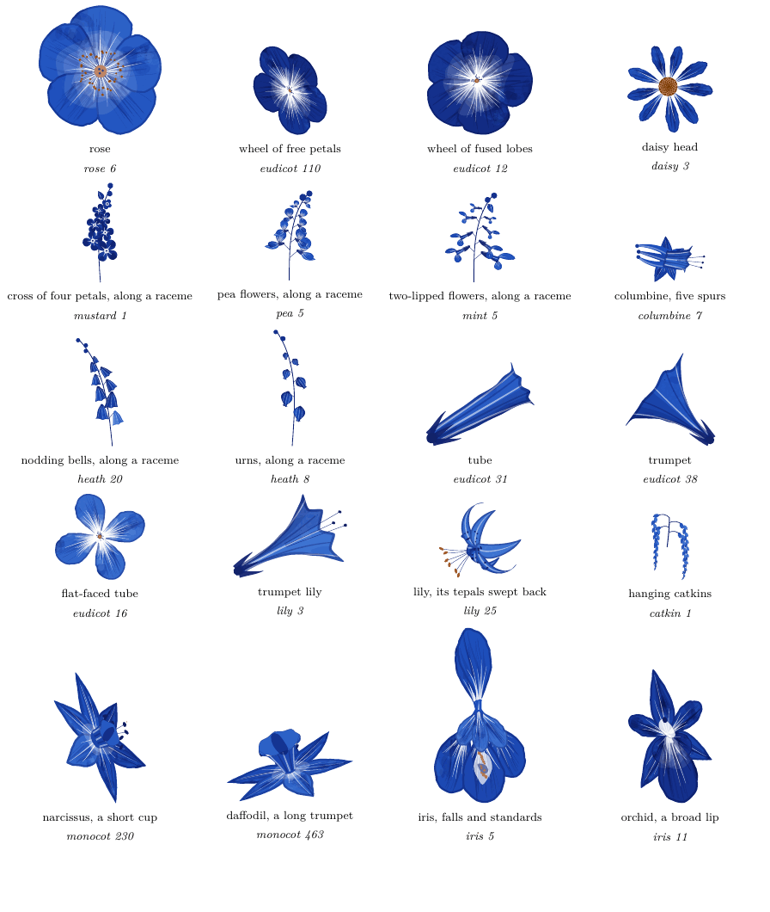
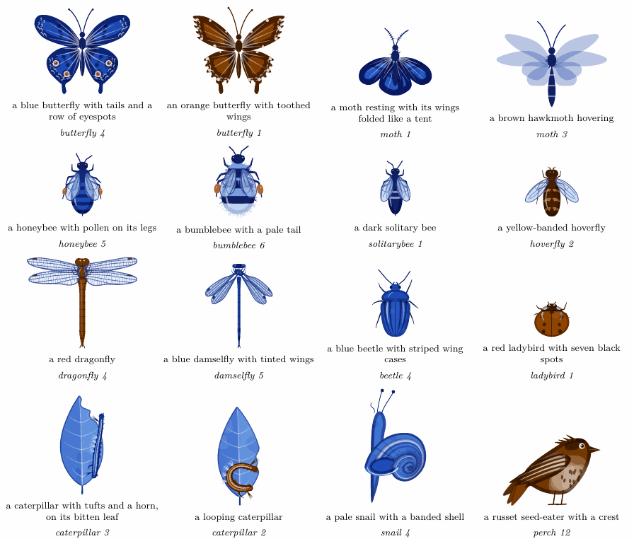
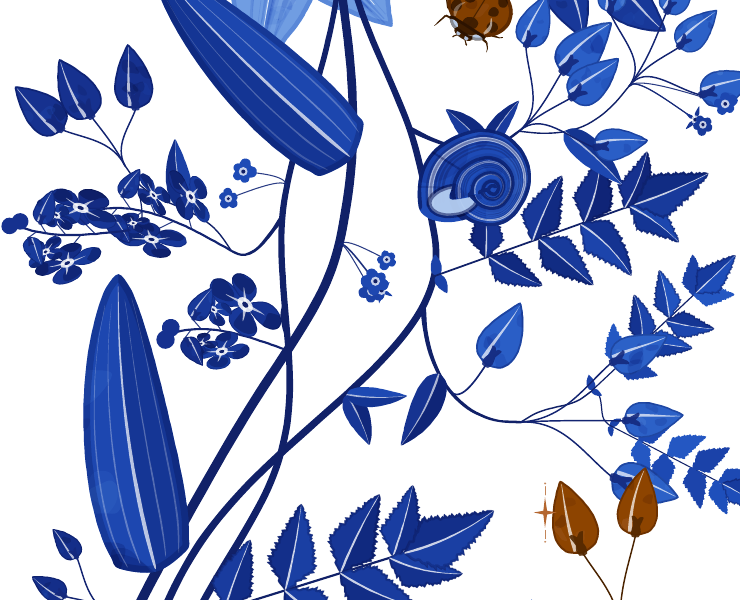

# The species garden

In 2.0, the plants of a grown margin are not drawn from a fixed set of shapes. Each one is a
*species*, a table of traits sampled from a genome. They say what kind of plant it is, the
visitor its flowers are for, the flower, how its flowers are clustered, the leaf, the stem and the fruit.
A document gets eight species, each page grows four of them, and the animals that come to the
page are sampled the same way.

*Every flower form, each as its plant holds it, from `specimen-tikz.tex`.*

## A genome

A species is 62 traits, always drawn in the same order. The first is the *body plan*, which
fixes the clade (monocot, eudicot or fern) and gives every later trait its distribution. There
are fourteen flowering plans (lily, iris, rose, mustard, pea, mint, daisy, umbellifer, heath,
borage, catkin, columbine, and a generic eudicot and monocot) and the fern.

| part | what the genome decides |
|---|---|
| visitor | the pollination syndrome (bee, butterfly, moth, bird, beetle, fly or wind), which weights the color |
| flower | one of eight colors and fifteen forms (wheel, rose, cross, bell, urn, tube, funnel, salver, two-lipped, pea, orchid, iris, lily, spurred, head); symmetry, fused or free petals and how many; the petal's shape, tip, edge and claw, how far it bends back; guide lines, dots, a blotch or an eye, a pale rim, a corona, spurs, stamens; whether it is held up, sideways or nodding |
| cluster | alone on its stalk, or a raceme, spike, panicle, thyrse, corymb, simple or compound umbel, forked or coiled cyme, head or catkin; how many flowers, in what order they open, how large they are |
| leaf | simple, or pinnate, bipinnate, palmate or trifoliate; one of twelve shapes, nine edges, six tips and six bases; pinnate, arcuate, palmate, parallel or forked veins; stalked, stalkless, clasping or sheathing; stipules; alternate, opposite, whorled, in a rosette or in two ranks; curled tips, hairs |
| stem | upright, sprawling, climbing or woody; its section and taper; tendrils on a climber's leaves |
| fruit and season | sixteen fruits, from a pea's pod and a rose's hip to a dandelion's clock; an early or a late flowerer |
| fern | fronds divided once, twice or three times, their outline, pinnae and stalk; the sori beneath, and a fertile frond of another shape |

A body plan bundles its traits, so the rules of botany hold by construction. A lily has its
parts in threes and its leaves smooth-edged, with parallel veins. A pea flower is two-sided,
with five petals and a pod. A cross of petals has four. A catkin has no petals and no visitor,
since the wind pollinates it. Only a radially symmetric flower may vary its number of petals
from flower to flower, as Damerval and Nadot (2007) found in the buttercup order. `tools/speciescheck.lua` samples
thousands of species and fails if any of them breaks a rule.

## In words

A species can describe itself, and the playground writes its page text from these sentences.
The eight of the document seed 7:

- A blue daisy head of nineteen rays alone on its stalk, for bees; lobed, narrow leaves; then small dry seeds.
- A five-petalled blue rose in forked cymes, for bees; deeply cut, oval leaves; then capsules.
- A blue wheel of five lobes in a coiled cyme that uncurls, for bees; hairy, smooth-edged, oval leaves; then nutlets.
- Tiny petal-less flowers in hanging catkins, pollinated by the wind; toothed, spoon-shaped leaves; then winged seeds.
- A violet lily of six swept-back tepals along a raceme, for butterflies; smooth-edged, narrow leaves with parallel veins; then capsules.
- A four-petalled nodding white rose in a flat-topped cluster, for flies and hoverflies; leaves of two pairs of toothed leaflets; then stone fruit.
- A blue pea flower along a raceme, for bees; leaves of five pairs of smooth-edged leaflets, climbing by tendrils; then pods.
- A white two-lipped flower in a dense spike, for bees; toothed, narrow leaves, in pairs; then nutlets.

## A genome of your own

Any trait can be fixed and the rest sampled, in the TikZ library's pics (`traits={compound=palmate,
leaflets=7}`) and with `\florilegiumspecies[...]`; see [the TikZ library](tikz.md#a-genome-of-your-own)
and [the traits](traits.md), which lists every trait and what it may be.

## A document's plants

The document's seed (`\def\florilegiumseed{7}`) picks its *pool* of eight species, two heroes,
two sprays, a monocot and three others, with no body plan twice. The heroes are showy, with single
flowers or loose clusters painted in the ink. A document without a seed has one pool, the
same in every such document, and its pages still differ.

Each page grows four of the eight. The hero takes the tallest main stem and opens its largest
flower at the top of the page; a second showy plant takes the second stem, the monocot the
third, and a spray runs along the footer. Which hero, which spray and which second plant come
to a page is the page's own draw, so the eight recur across a document the way plants recur
across a garden. On the last page, the arcs that reach into the space below the text come from
the stems in turn. On two pages in five, the document's fern grows from a crown beside the
root, two to four fronds leaning into the column, some unrolling, some turned to show their
spores.

The growth loop is v1.3's (see [how it works](how-it-works.md)). What changes is what it
places. Each plant brings its own rows to the loop, which are its inflorescence, buds, smaller
sprays, leaves at its nodes, a tendril if it climbs, and, for the hero, big flowers at the ends
of its side branches. A branch belongs to the plant whose stem it leaves, so a rose's branches carry
roses. Flowers are drawn larger than life, at the size of v1.3's, as an illustrator enlarges a
small flower.

## Visitors

*The visitors of `specimen-tikz.tex`, one or two of each kind.*

A visitor is sampled from a genome of its own, which has 15 kinds (butterfly, moth, hawkmoth, honeybee,
bumblebee, solitary bee, hoverfly, dragonfly, damselfly, beetle, ladybird, caterpillar, snail,
songbird, hummingbird) and 48 traits, such as a wing's tip, edge and tails, its pattern, a
bumblebee's bands, a beetle's spots, a snail's shell, a bird's bill, and the pose it
is seen in. A butterfly's pattern follows the systems of the nymphalid groundplan, with bands
near the body, a central band with its discal spot, a border band, eyespots with their rings and the
arcs outside them, and crescents at the edge.

A snail's shell is Raup's coiled tube. A ring the shape of its mouth sweeps round the coiling
axis, growing by the shell's expansion each turn and sliding along the axis as far as its spire
asks, so a shell can be flat, globular or tall. Seen from the spire's side, each whorl's two
edges are where the rings reach farthest across the coil, and the whorls are painted from the
mouth inward, each older one over the next, so its rim is the suture. A shell may be banded,
ribbed or corded and coils to the left once in twenty; one in a hundred is open-coiled, its last
whorl clear of the rest, and three in ten are withdrawn into the shell, its mouth sealed and no
foot showing.

Each plant whose flowers have a visitor brings it to the page, so a bee comes to a bee flower
and a hummingbird to a red tube, and so on for moths, butterflies, beetles and hoverflies. It
flies in near that plant's stems. Off the flowers, a snail climbs a main stem, a seed-eating bird perches on a twig of its
own, a caterpillar feeds on a bitten leaf, a dragonfly or a damselfly hunts by the monocot and
a ladybird climbs a stem.

*300 dpi. A snail on a main stem, and a ladybird climbing another.*

A page has about three visitors, as in v1.3, from a random stream of
their own, so `novisitors` leaves the plants exactly as they were.

## Seasons and headings

With the option `aging` (or `\florilegiumage`), each flower's stage comes from the season, its
place in its cluster and the species' phenology, so it is a bud, open, past its best or a fruit.
Spring brings buds and fiddleheads, autumn pods, hips, seed clocks and a few copper leaves.

With the option `sections`, a heading gets the flowers of the plant nearest to it, in the
accent's copper (buds for a subsection). `\florilegiumbloom[...]` takes `flower`, `bud`,
`leaf`, `tendril`, a role (`hero`, `showy`, `monocot`, `spray`) or the name of a body plan on
the page (`rose`, `lily`, ...).

## Drawn in v1.3's hand

Every organ is painted as v1.3's primitives were, with a flat wash, darker blotches multiplied
over it, pigment pooling at the edge, white streaks lifted out, a few fine veins. Petals, leaves and
stems keep v1.3's sizes and weights, so a species page reads like a v1.3 page with more kinds
of plant in it. The smallest petals, of which a daisy's flat cluster or a clover head holds
hundreds, are drawn more plainly below 1.2 mm, where the detail could not be seen.

A flower is seen as its form and its stalk hold it. It faces the reader when it is held up,
turns to a tilt when it is held sideways and shows its back and calyx when it nods; bells,
urns, tubes, trumpets, pea and two-lipped flowers are always seen in profile. A bell has a
shoulder under its flaring rim, and the shade on its far side follows its curve. A lily whose
tepals sweep back is seen from the side and a little from below, the tepals curling back
past its stalk and the stamens hanging out under them; a trumpet lily is a long tube that
flares at its mouth. Seen in profile, a flower reaches out from its stalk as a solid shape
nearly as long as it is wide, so at the top of a stem or alone on a branch it is drawn 0.72
times as large as a flower seen face on. A catkin is a tassel of overlapping scales, lit on
one side and shaded on the other, with the paper showing between them. A long strap leaf may
arch over toward the side it bends to (a broad one less), and a narrow one may twist edge on
and show its paler underside beyond the twist.

The organs are written twice, step for step, in plain Lua (`florilegium-native.lua`), which
draws the margin, and in TikZ (`tikzlibraryflorilegium.code.tex`), which draws them on their
own under pdfLaTeX (see [the TikZ library](tikz.md)).

## One seed, one species, in Lua or TikZ

Both sides draw from pgf's own random generator, which `florilegium-ink.lua` replays exactly.
Every choice is a whole-number draw, and a trait that is a real number is the very number
pgfmath computes from its draw, so `\florilegiumspecies{7}{hero}` in TikZ and
`species.sample(7, "hero")` in Lua find the same species (`tools/tikzcheck.lua` compares their
choices for a thousand seeds). The TikZ tables are generated from `florilegium-species.lua` by
`tools/tikztables.lua`, so the genome is written once.

The drawing itself is computed in pgfmath's arithmetic in TikZ and in floating point in Lua, so
the two drawings of a seed agree within a fraction of a point rather than byte for byte.
`tools/tikzcheck.lua draw` renders both and compares them, pixel by pixel and in total
darkness.

## Sources

The trait tables follow research notes made for this project, drawn from botanical glossaries
and the papers below.

- The rule that a variable number of petals goes with radial symmetry is the finding of
  C. Damerval and S. Nadot, *Evolution of perianth and stamen characteristics with respect to
  floral symmetry in Ranunculales* (Annals of Botany 100, 2007), in the buttercup order; here it
  holds for every body plan.
- Flowers and visitors are paired by the pollination syndromes of the U.S. Forest Service's
  [*Pollinator Syndromes*](https://www.fs.usda.gov/wildflowers/pollinators/What_is_Pollination/syndromes.shtml)
  page (its text; the photograph there is someone else's), as weights rather than rules, since
  real flowers draw many visitors (C. B. Fenster and others, *Pollination syndromes and floral
  specialization*, Annual Review of Ecology, Evolution, and Systematics 35, 2004).
- A snail's shell is the coiled tube of D. M. Raup, *Geometric analysis of shell coiling:
  general problems* (Journal of Paleontology 40, 1966), its ring placed as S. Okabe and
  J. Yoshimura reparameterize Raup's model in *Optimal designs of mollusk shells from bivalves
  to snails* (Scientific Reports 7, 2017), with the spire lower for a fast-widening coil, the
  negative relation they report. It is drawn from its whorls' edges, the simpler method for
  line drawings that the research notes describe.
- Heads and daisy discs are packed on Vogel's spiral (H. Vogel, *A better way to construct the
  sunflower head*, Mathematical Biosciences 44, 1979).
- A butterfly's pattern systems follow the nymphalid groundplan proposed by B. N. Schwanwitsch
  (*On the ground-plan of wing-pattern in nymphalids and certain other families of the
  rhopalocerous Lepidoptera*, Proceedings of the Zoological Society of London, 1924) and by
  F. Süffert (*Zur vergleichenden Analyse der Schmetterlingszeichnung*, Biologisches
  Zentralblatt 47, 1927; checked against the papers that cite it, not the original).
