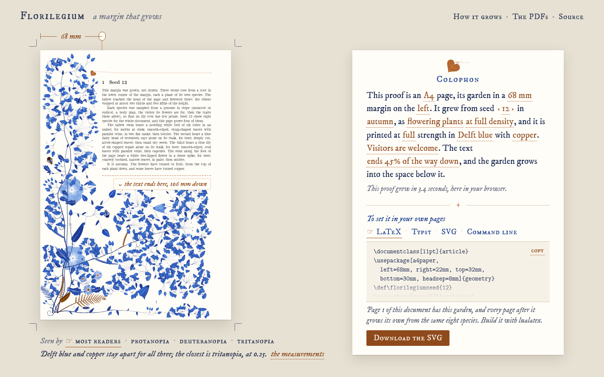

# SVG, Typst and the browser



*The [playground](https://kevinraymond.github.io/florilegium/), seed 12 in autumn on a last
page. The page is a proof, and its colophon, the note a book keeps about its paper, ink and
printing, is the set of controls: every copper word in it can be changed.*

## A page as SVG, without TeX

The same Lua can draw a page without TeX. `florilegium-svg.lua` runs the package's own code with
a small stand-in for the few parts of TeX it touches (the page's lengths, the page number, and
the node a drawing goes into), takes the PDF drawing commands that `florilegium-ink.lua` writes
as it always does, and rewrites them as SVG. Nothing in the drawing code changes, so the garden
is the one LuaLaTeX would draw, not an imitation of it.

```sh
texlua florilegium-svg.lua --seed 7 > margin.svg   # page 1 of a document with \def\florilegiumseed{7}
lua florilegium-svg.lua --seed 7 --season autumn --ink 5B2A1F --left 25mm --right 65mm > margin.svg
texlua florilegium-svg.lua --help                  # paper, margins, two-sided pages, the last page, themes...
make svg SEED=7                                    # -> build/svg-7.svg
```

A garden set on a page of its own, such as the part-title page of an e-book, does not end
where the paper does. The reader's screen, its margins and its theme lie all around it, and the
clip that keeps a printed margin inside the paper would cut the pale flowers along a straight
line in the middle of the screen. `--bleed LEN` leaves the clip open along the paper's edges,
so the garden may run up to LEN past them, and makes the SVG LEN larger on every side. The
sides that face the text keep their clip, so the space for a title stays empty. It works for
the grown page and the authored one; without it the SVG is the page LuaLaTeX draws.

```sh
lua florilegium-svg.lua --seed 3 --paper 120x200 --left 36mm --right 12mm --top 36mm --bottom 12mm \
  --headsep 0mm --headheight 0pt --textend 50mm --nohead --bleed 14mm > part-title.svg
```

Any Lua 5.3 or 5.4 runs it. Lengths are read the way TeX reads them and colors are converted
the way xcolor converts them, so `--seed 7` with the default margins gives, byte for byte, the
drawing on page 1 of `florilegium-grow.tex` built with seed 7. The SVG is a whole page with a
transparent background, which makes it a page background anywhere.

This command line, and the same options given to the `page` function of
`require("florilegium-svg")` as a table, are what other tools should build on. They stay put
from one release to the next, while the other files may be renamed or rewritten.

## In Typst

```typst
#set page(paper: "a4", margin: (left: 68mm, right: 22mm, top: 32mm, bottom: 30mm),
  background: image("margin.svg", width: 100%, height: 100%))
```

## The playground

The playground runs the same files in the browser with [wasmoon](https://github.com/ceifa/wasmoon),
Lua 5.4 compiled to WebAssembly, in a background worker; a species page grows in a few seconds.
Seed 7 there is seed 7 here.

The proof is the control surface as much as the colophon is: the measure above it sets the
margin, and dragging the foot of the text up makes a last page. The text on the proof describes
the garden that just grew, each plant in its own sentence and each visitor with what it did.
Under it, the page can be seen as readers with protanopia, deuteranopia or tritanopia see it,
with the distance between the ink and the accent measured for each (the model of Machado,
Oliveira and Fernandes, distances in Oklab); a pairing that is hard to tell apart is flagged
when you choose it. Next to the download are the LaTeX preamble, the Typst setup and the command
line that make the same garden, and the address bar keeps every setting, so a garden can be
shared as a link.

To run it from a clone, serve the repository with `make playground` and open
<http://localhost:8000/web/>. The math theme works too. Its figures come from the same Lua; its
equations and symbols, which TeX sets in a PDF, are set in the playground by MathJax in the same
Computer Modern, and the command line leaves them out. The fonts are served with the page (IM
FELL DW Pica, and Latin Modern renamed as its license asks), so nothing is fetched from a font
service.
