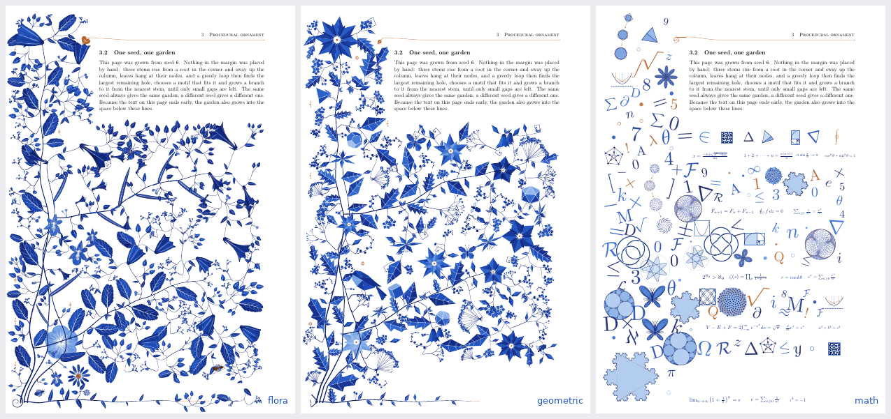

# Themes



*Seed 6 three times: the species garden, with `theme=geometric`, and with `theme=math`.*

```latex
\usepackage[grown,theme=geometric]{florilegium}   % or theme=math; the whole document
\florilegiumtheme{math}                            % or from the page this stands on
```

The growth loop never knew what it was drawing. It reads a table of motifs (the size of the
disc each one takes, a weight, a function that draws it) and calls every primitive by name. A
theme is one Lua file, `florilegium-theme-<name>.lua`, that replaces some of those primitives
and may add rows to the table, or brings a composition of its own. A themed page grows v1.3's
garden, with its hand-designed kinds, and draws it in the theme's way; the species belong to
the unthemed margin.

## Geometric

`theme=geometric` is v1.3's plant cut from flat shapes (`florilegium-theme-geometric.lua`). It
grows exactly as v1.3's flowers do, and only the drawing changes. The stems run straight
between their nodes, the leaves are kites and toothed polygons folded into a light and a dark
facet with straight white veins, the flowers are rosettes of rhombi or layered star polygons,
the tendrils square spirals, the bird and the butterfly low-poly. The colors are flat tones of
the ink, with no wash, and crystals (Platonic solids, flat-shaded like cut stones) grow among
the flowers. A page is about a tenth of the size of a painted one.


## Math

`theme=math` is no plant at all (`florilegium-theme-math.lua`, drawing from
`florilegium-figures.lua`). Mathematics cascades down the margin and across the bottom of the
page, overlapping a little so it blends. A large figure sits in the corner where the column
meets the bottom: an Apollonian gasket, a deep Koch snowflake, Vogel's disc, a polyhedron. Down
the column run one or two *families*, figures that change as they go, joined by small copper
arrows. The Koch snowflake gains a level, a polygon gains sides on its way to the circle, the
cube truncates into the octahedron, chords k → mk mod n turn from a cardioid into a nephroid,
and Vogel's disc packs evenly only at the golden angle.

Equations that hold (e^{iπ} + 1 = 0, V − E + F = 2, ...) run along the bottom and under the
text on the last page. Everything else, largest hole first, is figures (Platonic solids,
knots, Hilbert curves, Lissajous curves, hypotrochoids, Maurer roses, the Petersen graph, ...),
letters, numerals and symbols set by TeX at many sizes and a slight tilt, and dots. It fills
whatever space the page leaves, like the garden; `density` sets how much there is.


## Writing a theme

A theme returns its primitives by name, with the same arguments and frame as the ones they
replace (`flower(rng, s)` centered on its origin, `sprig(rng, L)` from its base along +y, ...),
and a function that may reweight the motif rows and add new ones:

```lua
-- florilegium-theme-<name>.lua
return {
  flora = { flower = function(rng, s) ... end, leaf = function(rng, L, o) ... end },
  motifs = function(rows, F) ... return rows end,
}
```

A theme with `page = function(g, grow)` gets the whole page instead and lays it out itself, as
`florilegium-theme-math.lua` does. `florilegium-theme-geometric.lua` is the example to start
from, and [CLAUDE.md](../CLAUDE.md) lists the rules a theme has to keep (the animation's,
mirrored pages', density's).
