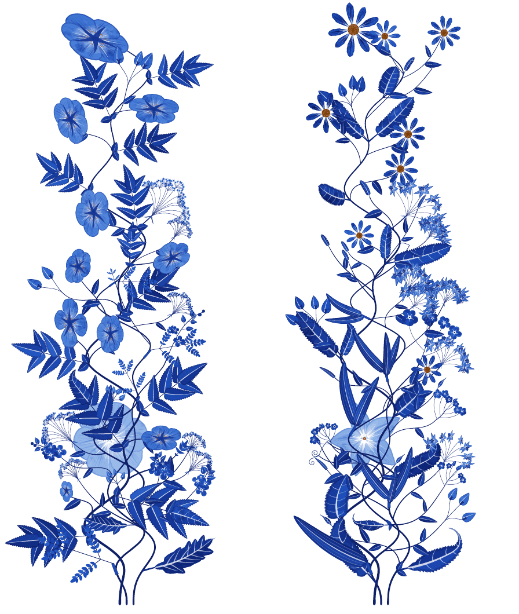

# The TikZ library

`\usetikzlibrary{florilegium}` draws the species of 2.0 in a TikZ picture, under pdfLaTeX or
LuaLaTeX. Under pdfLaTeX it is pure TikZ: every plant and every visitor is sampled from its
genome, grown and painted by pgfmath and TikZ, with no Lua at all. It is slow, about a minute
and a half for a strip of three plants 21 cm tall, but it is all TikZ. Under LuaLaTeX
the library draws the same plants with florilegium's Lua instead, about a hundred times faster.



*Two strips of three plants on one root, from `specimen-tikz.tex`.*

## Files

The library is two files, `tikzlibraryflorilegium.code.tex` (the drawing) and
`tikzlibraryflorilegium.tables.code.tex` (the genome's tables). Put them beside the document,
or in your TeX tree. It does not need `florilegium.sty`, and the two can be loaded together.
Under LuaLaTeX, its Lua engine needs `florilegium-native.lua`, `florilegium-species.lua`,
`florilegium-ink.lua` and `florilegium-pgfmath.lua` as well. Where `florilegium-native.lua`
can't be found, the library draws in pure TikZ.

```latex
\documentclass{article}
\usepackage{tikz}
\usetikzlibrary{florilegium}
\definecolor{ink}{HTML}{2456C4}        % optional: the hue of the palette (Delft blue)
\begin{document}
\begin{tikzpicture}
  \pic at (0,0) {florilegium flower={seed=7, role=hero, size=2.6cm}};
  \pic at (3,-1.3) {florilegium leaf={seed=7, role=hero, size=3.4cm}};
  \pic at (6,-1.3) {florilegium inflorescence={seed=20, role=heath, scale=1.3}};
  \pic at (10,0) {florilegium visitor={seed=3, role=butterfly, size=3cm}};
\end{tikzpicture}
\end{document}
```

## Pics

| pic | what it draws | keys |
|---|---|---|
| `florilegium flower` | one flower face on, `size` its diameter | `seed role size draw` |
| `florilegium leaf` | one leaf from its base along +y, `size` its length | `seed role size draw` |
| `florilegium inflorescence` | the species' cluster from its stalk's base along +y, as large as the margin's at `scale=1` | `seed role scale season draw` |
| `florilegium plant` | one plant from its root, `size` its height, its branches reaching about `width` | `seed role size width season` |
| `florilegium plants` | plants on one root, like a margin's main stems, the first `size` tall and the others 60–72% and 36–48% of it, with a pale flower of the first behind them | `plants={3/rose, 17/umbellifer, 29/mustard}`, `size width season ghost` |
| `florilegium fern` | a fern's crown, `size` its longest frond | `seed size season draw` |
| `florilegium visitor` | a visitor, `size` its wingspan, or its length | `seed role size draw` |

- `seed` picks the species (1 to 2147483646), and `role` narrows what it may be to `hero`,
  `spray`, `monocot`, `any` (the default), or a body plan (`rose`, `lily`, `pea`, `daisy`,
  `umbellifer`, ...). One seed and role is always one species.
- `draw` seeds the drawing, so one species can be drawn many ways; by default it is the
  species' seed plus one. A plant grows from its species' seed alone, so it has no `draw`.
- `seed`, `draw` and `season` may be anything pgfmath computes, such as `seed=10+\i` in a
  `\foreach`; a seed's digits after the point are dropped, as `\pgfmathsetseed` drops them.
- `season` is 0.3 for spring, 0.75 for summer (the default) and 1.25 for autumn, and sets each
  flower's stage, from bud to fruit.
- For a visitor, `role` is the visitor of a kind of flower (`bee`, `butterfly`, `moth`, `bird`,
  `beetle`, `fly`), one that lives off the flowers (`leaf`, `stem`, `perch`), `any`, or a kind
  (`ladybird`, `dragonfly`, `snail`, `hummingbird`, ...).
- `engine` is `auto` (the default), `lua` or `tikz`, for one pic or for all of them with
  `\pgfkeys{/florilegium/engine=tikz}`.
- `traits` fixes some of the species' or the visitor's traits and leaves the rest to the seed
  (see [your own genome](#a-genome-of-your-own)); in `plants`, every plant takes them.
- The colors are the document's `ink` and `accent`, as for the package; without them, Delft
  blue and copper.

The traits themselves can be read too:

```latex
\florilegiumspecies{7}{hero}      % sample a species without drawing it
\florilegiumtrait{plan}, \florilegiumtrait{merosity} parts, \florilegiumtrait{inflo}
\florilegiumvisitor{3}{any}       % and a visitor
\florilegiumvisitortrait{kind}
```

## A genome of your own

A pic's `traits` fixes traits by name, and the seed samples the rest. A palmate leaf of seven
toothed leaflets, or a simple leaf lobed like a maple's:

```latex
\pic {florilegium leaf={seed=7, size=4cm, traits={compound=palmate, leaflets=7, leafmargin=serrate}}};
\pic {florilegium plant={seed=12, role=eudicot, size=9cm, traits={compound=simple, leafmargin=palmatelobed}}};
\pic {florilegium visitor={seed=3, role=any, size=2cm, traits={kind=ladybird, spots=14}}};
\florilegiumspecies[plan=rose, color=white]{7}{any}   % the same, without drawing
```

[The traits](traits.md) lists every one and what it may be; a name the genome lacks, or a value
no plan can draw, is an error that says what the trait may be. A fixed trait still takes its
random draw, so the traits drawn before it are as the seed gave them, and those after it too,
unless one that depends on it draws differently (a palmate leaf draws how many leaflets it has,
a simple one does not), which moves every later draw along. A trait that depends on a fixed one
follows it, and a fixed `plan` (or a visitor's `kind`) brings its own distributions. Botany's
rules hold for what the genome samples; a fixed trait is taken as it is, so a lily with toothed
leaves is yours to ask for. Both engines fix traits the same way.

`specimen-tikz.tex` draws one of nearly everything, from the strips above to each body plan's flower
and leaf, every flower form and kind of cluster, every leaf, ferns, and the visitors.

## Engines

Under pdfLaTeX, and with `engine=tikz` under LuaLaTeX, pgfmath computes every point and TikZ
draws it. Under LuaLaTeX, `engine=auto` hands the pic to `florilegium-native.lua`, which takes
the same steps with the same random draws from pgf's generator, in floating point instead of
pgfmath's arithmetic, and paints into the picture. The two drawings of a seed agree within a
fraction of a point; `tools/tikzcheck.lua draw` renders both and compares them pixel by pixel
and in total darkness.

| one strip of three plants, 21 cm tall | time | PDF |
|---|---|---|
| pdfLaTeX, pure TikZ | 91 s | 1.3 MB |
| LuaLaTeX, pure TikZ (`engine=tikz`) | 96 s | 1.3 MB |
| LuaLaTeX, Lua engine (the default) | 0.8 s | 0.5 MB |

*`tools/bench-tikz.tex`, timed by `make bench` on 2026-11-03 (Intel Core i9-13900K, TeX Live
2023).*

## pdfLaTeX's memory

pdfTeX keeps a page's drawing in its main memory until the page is shipped out. A strip of
plants in this much detail needs about 6.3 million words of it, more than the 5 million pdfTeX
has by default, and a full page of the specimen sheet about 12.5 million. TeX Live reads a
larger size from the environment at run time, with no format to rebuild:

```sh
extra_mem_top=10000000 pdflatex strip.tex
extra_mem_top=20000000 pdflatex specimen-tikz.tex
```

Without it, pdfLaTeX stops with "TeX capacity exceeded, sorry [main memory size]". LuaLaTeX's
memory grows as it needs to.

## What is TikZ, and what is not

Everything a pic draws is computed in TeX under pdfLaTeX: the species' traits, sampled with
pgf's own random numbers, and every point of every petal, leaf, stem, frond and wing. The
genome's tables in `tikzlibraryflorilegium.tables.code.tex` are plain TeX data, written once
from `florilegium-species.lua` by `tools/tikztables.lua`, so the genome is kept in one place.

What the library does not do is the page. Growing a margin around the text, the space under
the last line, a heading's flower, visitors placed by the plants they came for, and the
seasons over a document are the package's, and the package is Lua (LuaLaTeX only).

## A change to pgf at load time

pgfmath's number scanner leaves a name in TeX's string pool for every distinct number it reads,
and under pdfLaTeX a few thousand coordinates fill the pool. The library changes one line of
it when it loads, so that the lookup behind the name is made only after a leading 0, the only
place a base prefix can follow. Nothing else changes, and pgf's own files stay as they are.
The change applies only if that line is found in one of the two forms pgf has written it in
(pgf 3.1.10, and 3.1.12 in TeX Live 2026). Under another pgf the library leaves the scanner
alone and says so in a warning under pdfLaTeX, where a page of plants may then stop with "TeX
capacity exceeded, sorry [pool size]". Problems with the change belong to florilegium, not to
pgf's authors.
